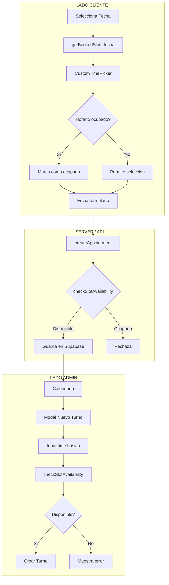

# Auditoría del Sistema de Calendario y Horarios

## Resumen Ejecutivo

Se realizó una revisión completa de la lógica del calendario tanto para el lado del cliente como del administrador. El sistema tiene una base sólida pero presenta **problemas críticos** que deben resolverse para evitar conflictos de horarios y mejorar la experiencia de usuario.

---

## 1. LADO CLIENTE (Reserva Pública)

### 1.1 Archivos Analizados

- [`ServiceContactForm.tsx`](portadora-eros/src/components/client/ServiceContactForm.tsx) - Formulario completo de reserva
- [`CustomTimePicker.tsx`](portadora-eros/src/components/client/CustomTimePicker.tsx) - Selector de hora personalizado
- [`appointments.ts`](portadora-eros/src/lib/api/appointments.ts) - Lógica de reservas (líneas 191-212)

### 1.2 Lo que FUNCIONA ✅

| Funcionalidad | Estado | Descripción |
|-------------|--------|-------------|
| Selección de fecha | ✅ Funciona | Input date con `min=hoy` |
| Horarios de trabajo | ✅ Funciona | Respeta configuración de `businessHours` |
| Días cerrados | ✅ Funciona | Muestra mensaje "Este día no hay turnos disponibles" |
| Validación de campos | ✅ Funciona | Requiere nombre, email, fecha y hora |
| Fetch de slots ocupados | ✅ Funciona | Llama a `getBookedSlots()` al cambiar fecha |

### 1.3 Lo que NO FUNCIONA ❌

#### 🔴 CRÍTICO: No considera la duración del servicio

**Problema**: El sistema solo bloquea el horario exacto (ej: 10:00), pero NO bloquea la ventana completa basada en la duración del servicio.

**Ejemplo del bug**:
- Servicio: Lectura de Tarot (60 minutos)
- Cliente A reserva: 10:00
- Sistema bloquea solo: 10:00
- Cliente B puede reservar: 10:30 (¡CONFLICTO!)
- Ambos turnos se superponen (10:00-11:00 y 10:30-11:30)

**Código problemático** en [`CustomTimePicker.tsx:138-156`](portadora-eros/src/components/client/CustomTimePicker.tsx:138):
```typescript
const isBooked = bookedSlots.includes(timeToCheck); // ❌ Solo verifica el minuto exacto
```

**Ubicación del problema en [`appointments.ts:191-212`](portadora-eros/src/lib/api/appointments.ts:191)**:
```typescript
export async function getBookedSlots(dateStr: string) {
  // Retorna solo HH:mm, no considera duración
  return data.map(app => {
    const d = new Date(app.appointment_date);
    return `${d.getUTCHours().toString().padStart(2, '0')}:${d.getUTCMinutes().toString().padStart(2, '0')}`;
  });
}
```

---

## 2. LADO ADMIN (Panel de Administración)

### 2.1 Archivos Analizados

- [`admin/calendario/page.tsx`](portadora-eros/src/app/admin/calendario/page.tsx) - Calendario principal
- [`admin/configuracion/horarios/page.tsx`](portadora-eros/src/app/admin/configuracion/horarios/page.tsx) - Configuración de horarios

### 2.2 Lo que FUNCIONA ✅

| Funcionalidad | Estado | Descripción |
|-------------|--------|-------------|
| Vista mes/semana/día | ✅ | Cambio entre vistas disponible |
| Crear turno manual | ✅ | Modal con todos los campos |
| Validación de conflictos | ✅ | `checkSlotAvailability` verifica duración |
| Bloquear fechas | ✅ | Modal para bloquear días/horarios |
| Confirmar/cancelar turnos | ✅ | Funcionalidad en lista de turnos |
| Sincronización realtime | ✅ | Supabase channel actualiza automáticamente |
| Cálculo de hora fin | ✅ | Muestra "Termina a las XX:XX" |

### 2.3 Lo que NO FUNCIONA ❌

#### 🟡 MODERADO: Admin no ve los horarios ocupados visualmente

**Problema**: El modal de nuevo turno ([`page.tsx:139-152`](portadora-eros/src/app/admin/calendario/page.tsx:139)) usa un `<input type="time">` básico sin mostrar qué horarios ya están ocupados.

**Impacto**: El admin debe recordar o consultar externamente qué horarios tienen turnos, lo cual es mala experiencia de usuario.

#### 🟡 MODERADO: No hay lista visual de turnos del día

**Problema**: Al seleccionar un día en el calendario, no se muestra claramente la lista de turnos de ese día junto con el formulario de creación.

---

## 3. PROBLEMAS ADICIONALES

### 3.1 API Route No Utilizada ⚠️

**Archivo**: [`api/appointments/route.ts`](portadora-eros/src/app/api/appointments/route.ts)

**Problema**: Existe una ruta API REST que NO se utiliza. El sistema usa Server Actions en [`lib/api/appointments.ts`](portadora-eros/src/lib/api/appointments.ts) en su lugar.

**Recomendación**: Eliminar o documentar como legacy.

### 3.2 Problemas de Zona Horaria 🕐

**Ubicación**: [`appointments.ts:198-200`](portadora-eros/src/lib/api/appointments.ts:198)

```typescript
.filter('appointment_date', 'gte', `${dateStr}T00:00:00Z`)
.filter('appointment_date', 'lte', `${dateStr}T23:59:59Z`)
```

**Problema**: Usa UTC固定的, pero debería usar la zona horaria Argentina (America/Buenos_Aires, UTC-3).

---

## 4. RECOMENDACIONES DE CORRECCIÓN

### Prioridad Alta (Crítico)

| # | Problema | Solución Propuesta |
|---|----------|-------------------|
| 1 | Client no considera duración | Modificar `getBookedSlots` para retornar rangos (inicio + duración) y actualizar `CustomTimePicker` para bloquear toda la ventana |

### Prioridad Media (Importante)

| # | Problema | Solución Propuesta |
|---|----------|-------------------|
| 2 | Admin no ve horarios ocupados | Agregar lista visual de slots ocupados en el modal de nuevo turno |
| 3 | Zona horaria | Ajustar consultas para usar timezone Argentina |

### Prioridad Baja (Limpieza)

| # | Problema | Solución Propuesta |
|---|----------|-------------------|
| 4 | API route sin usar | Eliminar archivo `api/appointments/route.ts` |

---

## 5. DIAGRAMA DE FLUJO ACTUAL



---

## 6. CONCLUSIÓN

El sistema tiene una **arquitectura correcta** pero necesita correcciones en:

1. **Lógica de冲突** (client side) - El bug más crítico
2. **Visualización de horarios** (admin side) - Mejora de UX
3. **Zona horaria** - Corrección técnica
4. **Limpieza de código** - Eliminar dead code

Las Server Actions en [`lib/api/appointments.ts`](portadora-eros/src/lib/api/appointments.ts) funcionan correctamente, especialmente la función [`checkSlotAvailability`](portadora-eros/src/lib/api/appointments.ts:310) que SÍ considera la duración del servicio. El problema está en que el cliente no usa esta lógica correctamente.
