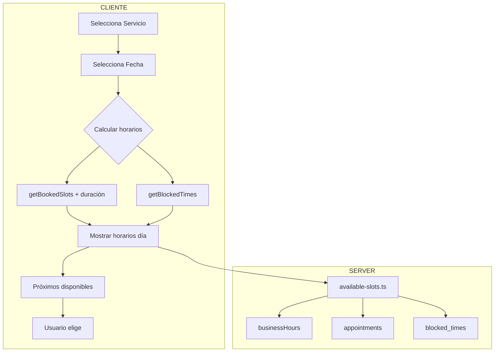

# Plan de Mejoras: Calendario Cliente

> Parte de: [[projects/eros/README|README]] · Relacionados: [[EROS-plan-2026-09-14]] ·
> [[INDICE-PLANS]] · [[plan_mejoras_calendario]]

## Problemas a Resolver

1. **Bug crítico**: El cliente puede reservar horarios que se superponen con turnos existentes (no
   considera duración del servicio)
2. **Falta visualización**: Cliente no ve los horarios bloqueados por el admin
3. **UX mejorable**: No muestra próximos horarios disponibles

## Solución Propuesta

### Flujo Nuevo:

1. Cliente selecciona servicio → ve selector de fecha
2. Selecciona un día → ve horarios disponibles de ese día
3. Debajo del selector, muestran los **próximos 3-5 horarios disponibles** en días posteriores

---

## Tareas de Implementación

### 1. Corregir `getBookedSlots` para considerar duración ⏰

**Archivo**: `src/lib/api/appointments.ts`

**Cambio**: Modificar la función para que retorne no solo el horario ocupado, sino toda la ventana
de tiempo basada en la duración del servicio.

```typescript
// ACTUAL (problemático):
return data.map((app) => `${horas}:${minutos}`); // Solo HH:mm

// NUEVO:
// Retornar array de horarios ocupados incluyendo la duración
// Ej: si hay turno a 10:00 con duración 60min, bloquear 10:00, 10:15, 10:30, 10:45
```

### 2. Obtener horarios bloqueados por admin 📅

**Archivo**: `src/lib/api/blocked-times.ts` (ya existe)

**Cambio**: El cliente debe llamar a `getBlockedTimesByMonth()` o similar para obtener los
días/horarios bloqueados por el admin y mostrarlos.

### 3. Crear función de "próximos disponibles" 🎯

**Nuevo archivo o función**: `src/lib/api/available-slots.ts`

**Lógica**:

- Input: duración del servicio, cantidad de días a buscar
- Output: próximos 3-5 horarios disponibles
- Considera: businessHours, turnos ocupados, horarios bloqueados

### 4. Actualizar `ServiceContactForm` 📝

**Archivo**: `src/components/client/ServiceContactForm.tsx`

**Cambios**:

- Importar y usar horarios bloqueados
- Mostrar "próximos disponibles" debajo del selector
- Mejorar visualización de fechas no disponibles

### 5. Actualizar `CustomTimePicker` o crear componente nuevo 🕐

**Opciones**:

- Opción A: Mejorar el actual `CustomTimePicker`
- Opción B: Crear un componente de "selector de fecha" con mini-calendario

**Recomendación**: Opción A más simple - mantener el selector actual pero mejorar la lógica de
bloqueo.

---

## Diagrama de la Nueva Arquitectura



---

## Orden de Implementación Sugerido

| #   | Tarea                                  | Prioridad | Dificultad |
| --- | -------------------------------------- | --------- | ---------- |
| 1   | Corregir `getBookedSlots` con duración | 🔴 Alta   | Media      |
| 2   | Obtener `blocked_times` en cliente     | 🟡 Media  | Baja       |
| 3   | Crear función "próximos disponibles"   | 🟡 Media  | Media      |
| 4   | Actualizar UI con próximos horarios    | 🟡 Media  | Baja       |

---

## Notas Adicionales

- Mantener la lógica sencilla como solicitaste
- El servidor ya tiene `checkSlotAvailability` que funciona bien - usar esa validación como fallback
- La zona horaria (Argentina) debe considerarse en todos los cálculos
