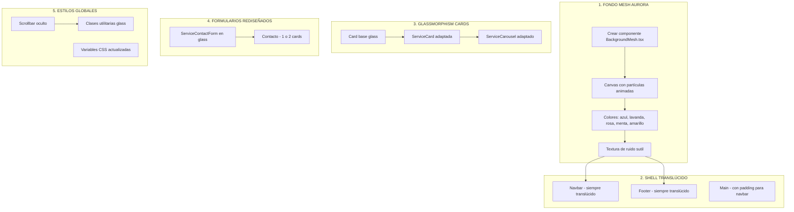

# Plan de Implementación: Fondo Mesh Aurora + Glassmorphism

## Visión General

Transformar el sitio actual (fondo blanco, cards blancas con bordes) a un diseño con:

- **Fondo animado tipo mesh/aurora** con tonos pastel vibrantes
- **Cards con efecto glassmorphism** (fondo translúcido, blur, borde sutil)
- **Navbar y footer translúcidos** para que el fondo se vea en todo el sitio
- **Scrollbar invisible**
- **Adaptar los componentes problemáticos** (cards que se ponían negras, formularios)

---

## Estado Actual del Proyecto

### Componentes analizados:

| Componente            | Archivo                  | Estado Actual                                   |
| --------------------- | ------------------------ | ----------------------------------------------- |
| Fondo                 | `globals.css`            | Blanco (#ffffff)                                |
| Navbar                | `Navbar.tsx`             | Cambia de transparente a blanco al hacer scroll |
| Footer                | `Footer.tsx`             | Blanco con backdrop-blur                        |
| Cards                 | `Card.tsx`               | Blancas con borde gris                          |
| ServiceCard           | `ServiceCard.tsx`        | Hover: fondo negro completo                     |
| ServiceCarousel       | `ServiceCarousel.tsx`    | Cards blancas con efecto                        |
| Formulario (servicio) | `ServiceContactForm.tsx` | Fondo negro completo                            |
| Formulario (contacto) | `contacto/page.tsx`      | Formulario sueltos con cards info               |
| Scrollbar             | `globals.css`            | Visible (4px)                                   |

---

## Arquitectura de la Solución

---

## Plan de Implementación (Orden de Ejecución)

### FASE 1: Fondo Mesh Aurora

#### Tarea 1.1: Crear componente BackgroundMesh

- **Archivo nuevo**: `src/components/client/BackgroundMesh.tsx`
- Canvas con 7 partículas de gradiente radial
- Colores pastel: `#87CEFA`, `#D8B4E2`, `#FFB6C1`, `#98FB98`, `#FFEB99`
- Fondo base: `#f8f9fb`
- Movimiento lento (velocidad 0.5-1.0)
- Textura de ruido SVG opcional
- **Responsable**: Modo Code

#### Tarea 1.2: Integrar fondo en Layout

- **Archivo**: `src/app/layout.tsx`
- Añadir `<BackgroundMesh />` como fondo fijo
- Ajustar z-index para que esté detrás del contenido
- **Responsable**: Modo Code

---

### FASE 2: Shell y Navegación Translúcida

#### Tarea 2.1: Actualizar Navbar

- **Archivo**: `src/components/client/Navbar.tsx`
- Siempre glassmorphism (no solo al hacer scroll)
- Fondo: `rgba(255, 255, 255, 0.15)` + `backdrop-blur(20px)`
- Borde inferior sutil: `1px solid rgba(255, 255, 255, 0.3)`
- Texto en negro con opacidad para contraste
- Sombra sutil opcional
- **Responsable**: Modo Code

#### Tarea 2.2: Actualizar Footer

- **Archivo**: `src/components/client/Footer.tsx`
- Glassmorphism igual que Navbar
- Fondo: `rgba(255, 255, 255, 0.1)` + `backdrop-blur(16px)`
- Bordes y texto con opacidad reducida
- **Responsable**: Modo Code

---

### FASE 3: Componentes Glassmorphism

#### Tarea 3.1: Crear clase utilitaria glass

- **Archivo**: `src/app/globals.css`
- Nueva clase `.glass` con propiedades:
  - `background: rgba(255, 255, 255, 0.25)`
  - `backdrop-filter: blur(20px)`
  - `-webkit-backdrop-filter: blur(20px)`
  - `border: 1px solid rgba(255, 255, 255, 0.4)`
  - `box-shadow: 0 8px 32px rgba(0, 0, 0, 0.08)`
- Variantes: `.glass-sm`, `.glass-lg`, `.glass-dark` (para contenido oscuro)
- **Responsable**: Modo Code

#### Tarefa 3.2: Actualizar Card base

- **Archivo**: `src/components/ui/Card.tsx`
- Cambiar de fondo blanco a glass
- Mantener bordes sutiles pero en versión glass
- **Responsable**: Modo Code

#### Tarea 3.3: Actualizar ServiceCard (hover problemático)

- **Archivo**: `src/components/client/ServiceCard.tsx`
- **CAMBIO CLAVE**: Eliminar el efecto de ponerse negra
- Nuevo hover: transición glass más pronunciada o efecto de elevación
- Texto siempre legible (no fondo negro)
- Posibles opciones:
  - Glass más intenso en hover
  - Borde destacado
  - Sombra expandida
  - Brillo sutil
- **Responsable**: Modo Code

#### Tarea 3.4: Actualizar ServiceCarousel

- **Archivo**: `src/components/client/ServiceCarousel.tsx`
- Cards del carrusel con efecto glass
- Eliminar efectos de escala de grises
- **Responsable**: Modo Code

---

### FASE 4: Formularios

#### Tarea 4.1: Rediseñar ServiceContactForm

- **Archivo**: `src/components/client/ServiceContactForm.tsx`
- **PROBLEMA ACTUAL**: Fondo negro completo, no contrasta con mesh
- **SOLUCIÓN**: Convertir a glass card
- Mantener la lógica de pasos (4 pasos)
- Texto legible sobre fondo glass (probablemente нужно texto oscuro)
- Fondo: glass con opacidad mayor para legibilidad (`rgba(255,255,255,0.35)`)
- O considerar versión "glass oscuro" si el texto blanco es esencial
- **Responsable**: Modo Code

#### Tarea 4.2: Rediseñar página de contacto

- **Archivo**: `src/app/contacto/page.tsx`
- Convertir formulario en glass card
- Card de información también en glass
- Reducir de múltiples componentes a 1-2 cards cohesionadas
- **Responsable**: Modo Code

---

### FASE 5: Scrollbar y Ajustes Finales

#### Tarea 5.1: Ocultar scrollbar

- **Archivo**: `src/app/globals.css`
- Actualizar scrollbar:
  - `width: 0` o `display: none`
  - Alternativa: `scrollbar-width: none` (Firefox)
  - Webkit: `::-webkit-scrollbar { display: none; }`
- **Responsable**: Modo Code

#### Tarea 5.2: Ajustar páginas específicas

- `src/app/servicios/[slug]/page.tsx` - Background del formulario
- `src/app/sobre-mi/page.tsx` - Cards de valores con glass
- `Hero.tsx` - Ajustar contraste de texto
- **Responsable**: Modo Code

#### Tarea 5.3: Testing y ajustes

- Verificar contraste de texto en todas las páginas
- Verificar que el formulario sea usable
- Ajustar opacidades según sea necesario
- **Responsable**: Modo Code

---

## Archivos a Modificar

### Archivos Nuevos (1):

- `src/components/client/BackgroundMesh.tsx`

### Archivos a Modificar (14):

| #   | Archivo                                        | Tipo de Cambio          |
| --- | ---------------------------------------------- | ----------------------- |
| 1   | `src/app/layout.tsx`                           | Añadir BackgroundMesh   |
| 2   | `src/app/globals.css`                          | Clases glass, scrollbar |
| 3   | `src/components/client/Navbar.tsx`             | Glass permanente        |
| 4   | `src/components/client/Footer.tsx`             | Glass permanente        |
| 5   | `src/components/ui/Card.tsx`                   | Estilo glass            |
| 6   | `src/components/client/ServiceCard.tsx`        | Quitar hover negro      |
| 7   | `src/components/client/ServiceCarousel.tsx`    | Cards glass             |
| 8   | `src/components/client/ServiceContactForm.tsx` | Glass card              |
| 9   | `src/app/contacto/page.tsx`                    | 1-2 cards glass         |
| 10  | `src/app/servicios/[slug]/page.tsx`            | Ajustes                 |
| 11  | `src/app/sobre-mi/page.tsx`                    | Values glass            |
| 12  | `src/components/client/Hero.tsx`               | Contraste texto         |
| 13  | `src/components/ui/InfoCard.tsx`               | Glass                   |
| 14  | `src/app/page.tsx`                             | Ajustes menores         |

---

## Esfuerzo Estimado

### Complejidad: MEDIA-ALTA

- **Fondo mesh**: Componente nuevo pero código fournido (del ejemplo)
- **Glassmorphism**: CSS básico, requiere ajustes de contraste
- **ServiceCard**: Cambio de comportamiento de hover - requiere pruebas
- **Formularios**: Rediseño de UI, mantener funcionalidad

### Riesgos Potenciales:

1. Contraste de texto en glass cards (mitigar con pruebas)
2. Rendimiento del canvas con animaciones (mitigar: partículas limitadas)
3. Compatibilidad con backdrop-filter (mitigar: fallback para Safari antiguo)

---

## Screenshots de Referencia

El usuario proporcionó un ejemplo funcional con:

- Fondo: `#f8f9fb` (casi blanco)
- 5 colores pastel en movimiento lento
- Glass card de ejemplo: `rgba(255,255,255,0.4)` + `blur(20px)`
- Este será el modelo a seguir

---

## Siguiente Paso

¿El plan te parece bien? ¿Hay algo que quieras modificar o agregar antes de pasar a la implementación?

Una vez aprobado, puedo empezar con la Fase 1 (Fondo Mesh Aurora) en modo Code.
