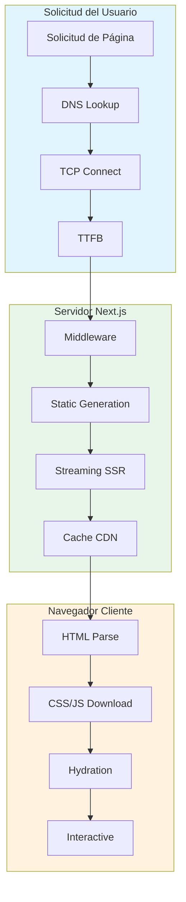
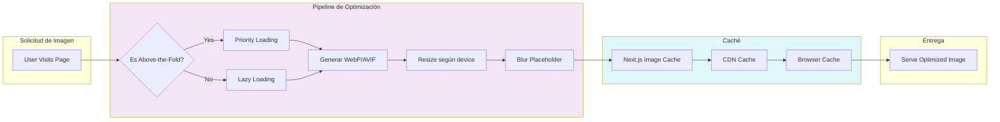
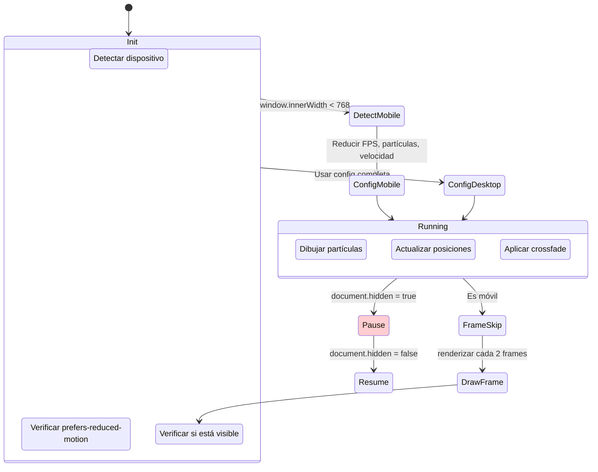
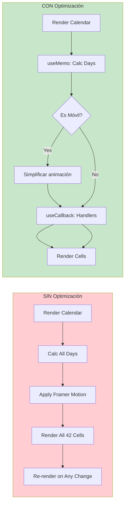
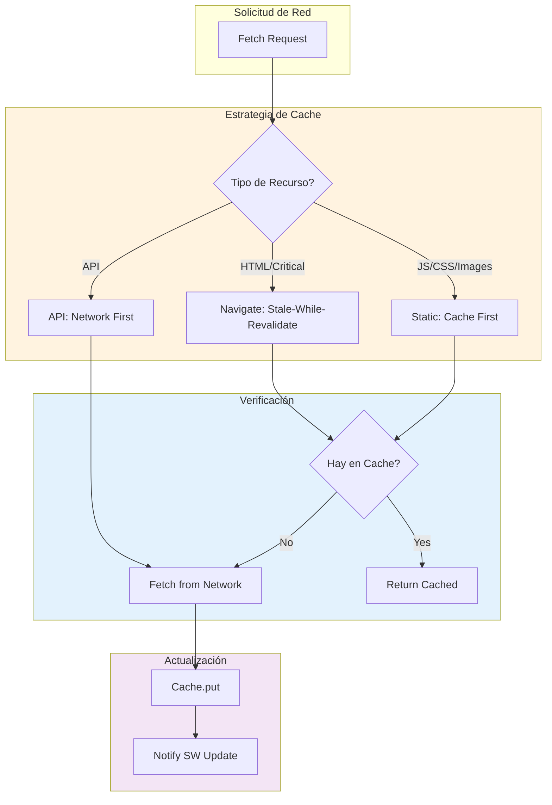

# Plan de Implementación - Optimización Móvil Integral

**Proyecto:** Portadora de Eros  
**Fecha:** 18 Marzo 2026  
**Objetivo:** Mejorar rendimiento en móviles y PCs de todas las gamas

---

## Fase 1: Optimización Crítica (Impacto Alto)

### 1.1 Fondo Dinámico - Optimización de Rendimiento

El [`BackgroundMesh.tsx`](portadora-eros/src/components/client/BackgroundMesh.tsx) es el componente más problemático para móviles.

**Problemas identificados:**

- Animación continua a 60fps consume batería y CPU
- No detecta visibility change (sigue corriendo en tabs background)
- Partículas muy grandes en móvil (baseSize calcula con width \* 0.55)
- No hay fallback para dispositivos de bajo rendimiento

**Solución implementada:**

```typescript
// BackgroundMesh.tsx - Optimizado
"use client";

import React, { useEffect, useRef, useState } from "react";

// Configuración optimizada para móvil
const MOBILE_FRAMES_PER_PAIR = 210; // ~3.5s en móvil (mitad de desktop)
const DESKTOP_FRAMES_PER_PAIR = 420; // ~7s en desktop
const PARTICLE_SPEED_MOBILE = 0.25; // Mitad de velocidad
const PARTICLE_SPEED_DESKTOP = 0.55;
const MOBILE_PARTICLE_REDUCTION = 0.5; // 50% menos partículas

export default function BackgroundMesh(): React.JSX.Element {
  const canvasRef = useRef<HTMLCanvasElement>(null);
  const [isMobile, setIsMobile] = useState(false);
  const [prefersReducedMotion, setPrefersReducedMotion] = useState(false);

  useEffect(() => {
    // Detectar móvil
    const checkMobile = () => {
      setIsMobile(window.innerWidth < 768 || "ontouchstart" in window);
    };
    checkMobile();
    window.addEventListener("resize", checkMobile);

    // Detectar preferencia de movimiento reducido
    const mediaQuery = window.matchMedia("(prefers-reduced-motion: reduce)");
    setPrefersReducedMotion(mediaQuery.matches);
    const handler = (e: MediaQueryListEvent) =>
      setPrefersReducedMotion(e.matches);
    mediaQuery.addEventListener("change", handler);

    return () => {
      window.removeEventListener("resize", checkMobile);
      mediaQuery.removeEventListener("change", handler);
    };
  }, []);

  // Usar configuración según dispositivo
  const FRAMES_PER_PAIR = isMobile
    ? MOBILE_FRAMES_PER_PAIR
    : DESKTOP_FRAMES_PER_PAIR;
  const SPEED = prefersReducedMotion
    ? 0
    : isMobile
      ? PARTICLE_SPEED_MOBILE
      : PARTICLE_SPEED_DESKTOP;

  // Reducir partículas en móvil
  const getParticleCount = (baseCount: number) =>
    isMobile ? Math.floor(baseCount * MOBILE_PARTICLE_REDUCTION) : baseCount;

  // VISIBILITY API - Pausar cuando no está visible
  useEffect(() => {
    let rafId: number;
    let isVisible = true;

    const handleVisibilityChange = () => {
      isVisible = !document.hidden;
      if (!isVisible) {
        cancelAnimationFrame(rafId);
      } else if (isVisible && shouldStart) {
        drawFrame();
      }
    };

    document.addEventListener("visibilitychange", handleVisibilityChange);
    return () =>
      document.removeEventListener("visibilitychange", handleVisibilityChange);
  }, []);

  // Optimización: Frame skipping para móvil
  let frameSkip = 0;
  const shouldDraw = isMobile ? frameSkip++ % 2 === 0 : true;
}
```

### 1.2 Transiciones CSS - Optimización de Velocidad

En [`globals.css`](portadora-eros/src/app/globals.css), optimizar las transiciones:

```css
/* Transiciones optimizadas para móvil */
@layer utilities {
  /* Transiciones rápidas por defecto */
  .transition-fast {
    transition-duration: 150ms !important;
  }

  .transition-normal {
    transition-duration: 200ms !important;
  }

  /* Feedback instantáneo para botones */
  .btn-primary,
  .btn-outline {
    transition:
      background 150ms ease,
      border-color 150ms ease,
      transform 100ms ease;
  }

  .btn-primary:active {
    transform: scale(0.97) translateY(0);
  }

  /* Optimización de backdrop-filter */
  .glass,
  .glass-opaque,
  .glass-subtle {
    will-change: transform, opacity;
  }
}

/* Mobile: desactivar animaciones complejas */
@media (max-width: 768px) {
  .glass-hover:hover {
    transform: none;
  }

  /* Simplificar animaciones en móvil */
  * {
    animation-duration: 0.01ms !important;
    transition-duration: 0.15s !important;
  }
}

/* Reduced motion - accessibility */
@media (prefers-reduced-motion: reduce) {
  *,
  *::before,
  *::after {
    animation-duration: 0.01ms !important;
    animation-iteration-count: 1 !important;
    transition-duration: 0.01ms !important;
  }
}
```

---

## Fase 2: Imágenes y Carga

### 2.1 Configuración de Next/Image

Optimizar [`next.config.ts`](portadora-eros/next.config.ts):

```typescript
import type { NextConfig } from "next";

const nextConfig: NextConfig = {
  reactCompiler: true,

  // Optimizaciones de rendimiento
  experimental: {
    optimizePackageImports: [
      "lucide-react",
      "date-fns",
      "@radix-ui/react-slot",
      "framer-motion",
    ],
  },

  // Image optimization mejorada
  images: {
    formats: ["image/avif", "image/webp"],
    deviceSizes: [320, 420, 640, 750, 828, 1080, 1200, 1920, 2048],
    imageSizes: [16, 32, 48, 64, 96, 128, 256, 384],
    minimumCacheTTL: 60 * 60 * 24 * 30, // 30 días
    remotePatterns: [
      {
        protocol: "https",
        hostname: "xvwmngtdzuzfnqelcjzf.supabase.co",
        port: "",
        pathname: "/storage/v1/object/public/**",
      },
    ],
    // Indicador de calidad adaptativo
    quality: 75,
  },

  // Compresión
  compress: true,

  // Generar menores bundles
  swcMinify: true,
};

export default nextConfig;
```

### 2.2 Optimización de Imágenes en Componentes

```typescript
// ServiceImageCarousel.tsx - Mejoras de rendimiento

// 1. Usar blur placeholder
<Image
  src={images[currentIndex]}
  alt={`Servicio ${currentIndex + 1}`}
  fill
  placeholder="blur"
  blurDataURL="data:image/jpeg;base64,...// Generar con: next/image-blur-placeholder"
  loading={currentIndex === 0 ? "eager" : "lazy"}
  priority={currentIndex === 0}
  sizes="(max-width: 768px) 100vw, (max-width: 1200px) 50vw, 33vw"
  quality={80}
  className="object-cover transition-opacity duration-300"
/>

// 2. Lazy load para todas las imágenes no críticas
// En Hero.tsx
<Image
  src="/hero.jpg"
  alt="Portadora de Eros"
  fill
  priority // Above the fold - cargar primero
  sizes="100vw"
/>

// En ServiceCard.tsx - no priority
<Image
  src={service.image}
  alt={service.title}
  fill
  loading="lazy"
  sizes="(max-width: 768px) 100vw, 50vw"
/>
```

---

## Fase 3: Responsive Cliente

### 3.1 ServiceCarousel - Optimización Mobile

Modificar [`ServiceCarousel.tsx`](portadora-eros/src/components/client/ServiceCarousel.tsx):

```typescript
// Línea 56 - Reducir altura en móvil
// ANTES: 'h-auto min-h-[340px] md:min-h-[380px] md:h-[380px]'
// DESPUÉS:
className={cn(
  'group relative flex flex-col md:flex-row h-auto',
  'min-h-[280px] md:min-h-[380px]', // Reducido de 340 a 280
  'rounded-[24px] md:rounded-[32px]', // Bordes más pequeños en móvil
  // ... resto sin cambios
)}

// Línea 384 - Ancho de card optimizado
// ANTES: 'w-[78%] md:w-[60%]'
// DESPUÉS:
className={cn(
  'shrink-0 w-[85%] sm:w-[70%] md:w-[60%] lg:w-[50%]' // Mejor adaptación
)}
```

### 3.2 Servicios Page - Grid Masonry

En [`servicios/page.tsx`](portadora-eros/src/app/servicios/page.tsx):

```typescript
// Grid optimizado para todos los tamaños
<div className={cn(
  "columns-1 sm:columns-2 lg:columns-3 gap-4 md:gap-6",
  // ANTES: 'columns-2 gap-4' - muy angosto en móviles pequeños
)}>

{/* Cards con altura dinámica */}
<ServiceCard
  className={cn(
    "min-h-[280px] md:min-h-[320px]", // Reducido de 340
    "break-inside-avoid mb-4 md:mb-6"
  )}
/>
```

### 3.3 Formulario de Contacto

En [`ServiceContactForm.tsx`](portadora-eros/src/components/client/ServiceContactForm.tsx):

```typescript
// Reducir altura mínima del contenedor
// ANTES: min-h-[520px]
// DESPUÉS:
<div className={cn(
  "min-h-[400px] md:min-h-[520px]",
  "p-4 md:p-8" // Padding reducido en móvil
)}>

{/* Botones más compactos en móvil */}
// ANTES: py-7 py-6
// DESPUÉS:
<button className={cn(
  "py-4 md:py-6 px-6 md:px-8", // Más pequeño en móvil
  "text-sm md:text-base"
)}>
```

---

## Fase 4: Responsive Admin

### 4.1 Calendario Admin - Touch Optimized

Optimizar [`admin/calendario/page.tsx`](portadora-eros/src/app/admin/calendario/page.tsx):

```typescript
// Botones de navegación del calendario - más grandes en touch
<button
  type="button"
  onClick={prevMonth}
  className={cn(
    "p-2 md:p-2", // Mantener tamaño consistente
    "min-w-[44px] min-h-[44px]", // Área táctil mínima
    "flex items-center justify-center",
    "rounded-lg md:rounded-xl",
    "bg-gray-100 hover:bg-gray-200",
    "active:scale-95 transition-transform" // Feedback instantáneo
  )}
  aria-label="Mes anterior"
>

// Vista mensual - celdas más grandes en touch
<div className={cn(
  "grid grid-cols-7 gap-1 md:gap-2",
  "min-h-[44px] md:min-h-[60px]" // Celdas táctiles
)}>
```

### 4.2 Tablas con Scroll Horizontal

```typescript
// Componente reutilizable para tablas admin
export function ResponsiveTable({
  children,
  className
}: {
  children: React.ReactNode;
  className?: string;
}) {
  return (
    <div className={cn(
      "overflow-x-auto",
      "-mx-4 px-4 md:mx-0 md:px-0", // Espacio para scroll en móvil
      "scrollbar-thin scrollbar-thumb-gray-300"
    )}>
      <table className={cn(
        "w-full min-w-[600px]", // Ancho mínimo para scroll
        "text-sm md:text-base",
        className
      )}>
        {children}
      </table>
    </div>
  );
}
```

---

## Fase 5: Calendarios - Optimización

### 5.1 BookingCalendar - useMemo/useCallback

Optimizar [`BookingCalendar.tsx`](portadora-eros/src/components/client/BookingCalendar.tsx):

```typescript
"use client";

import { useState, useMemo, useCallback } from "react";
import { motion } from "framer-motion";
import { ChevronLeft, ChevronRight } from "lucide-react";

export function BookingCalendar({
  selectedDate,
  onDateSelect,
  businessHours,
}: BookingCalendarProps) {
  const [currentMonth, setCurrentMonth] = useState(() => new Date());

  // Memoizar cálculos costosos
  const calendarData = useMemo(() => {
    const year = currentMonth.getFullYear();
    const month = currentMonth.getMonth();
    const totalDays = new Date(year, month + 1, 0).getDate();
    const startOffset = new Date(year, month, 1).getDay();
    return { year, month, totalDays, startOffset };
  }, [currentMonth]);

  const { year, month, totalDays, startOffset } = calendarData;

  // Memoizar funciones de navegación
  const prevMonth = useCallback(() => {
    setCurrentMonth(
      (prev) => new Date(prev.getFullYear(), prev.getMonth() - 1, 1),
    );
  }, []);

  const nextMonth = useCallback(() => {
    setCurrentMonth(
      (prev) => new Date(prev.getFullYear(), prev.getMonth() + 1, 1),
    );
  }, []);

  // Simplificar animación en móvil (Framer Motion puede ser pesado)
  const motionProps = {
    // En móvil: sin animación o animación simple
    ...(typeof window !== "undefined" && window.innerWidth < 768
      ? { transition: { duration: 0.15 } }
      : { layoutId: "activeDay" }),
  };
}
```

### 5.2 DatePicker UI - Optimizado

```typescript
// DatePicker.tsx - Animación más simple
<motion.div
  // Reducir o eliminar animación en móvil
  initial={isMobile ? false : { opacity: 0, scale: 0.98 }}
  animate={isMobile ? false : { opacity: 1, scale: 1 }}
  exit={isMobile ? false : { opacity: 0, scale: 0.98 }}
  transition={{ duration: isMobile ? 0 : 0.15 }}
  // El resto sin cambios
>
```

---

## Fase 6: Botones e Interactividad

### 6.1 Button Component - Optimizado

```typescript
// Button.tsx - Feedback instantáneo
import { cn } from "@/lib/utils";
import { cva, type VariantProps } from "class-variance-authority";
import { forwardRef } from "react";

const buttonVariants = cva(
  "inline-flex items-center justify-center gap-2 whitespace-nowrap rounded-full text-sm font-medium transition-all duration-150 focus-visible:outline-none focus-visible:ring-2 focus-visible:ring-offset-2 disabled:pointer-events-none disabled:opacity-50",
  {
    variants: {
      variant: {
        default: "bg-primary text-primary-foreground hover:bg-primary/90 active:scale-[0.97]",
        outline: "border border-input bg-background hover:bg-accent hover:text-accent-foreground active:scale-[0.97]",
        // ... resto
      },
      size: {
        default: "h-10 px-4 py-2 min-h-[44px]", // Área táctil mínima
        sm: "h-9 px-3 min-h-[36px]",
        lg: "h-12 px-8 min-h-[48px]",
        icon: "h-10 w-10 min-h-[44px] min-w-[44px]", // Botones cuadrados táctiles
      },
    },
    defaultVariants: {
      variant: "default",
      size: "default",
    },
  }
);

// Agregar en globals.css para feedback visual
:where(button) {
  -webkit-tap-highlight-color: transparent;
}

:where(button):active {
  transform: scale(0.97);
}
```

---

## Fase 7: PWA y Service Worker

### 7.1 Service Worker Optimizado

```javascript
// public/sw.js - Optimizado

const CACHE_NAME = "portadora-eros-v1";
const RUNTIME_CACHE = "runtime";

const PRECACHE_URLS = [
  "/",
  "/offline",
  "/manifest.json",
  // Fonts críticos
  "/fonts/playfair-display.woff2",
  "/fonts/geist.woff2",
];

// Install: precache recursos críticos
self.addEventListener("install", (event) => {
  event.waitUntil(
    caches.open(CACHE_NAME).then((cache) => {
      return cache.addAll(PRECACHE_URLS);
    }),
  );
  self.skipWaiting();
});

// Fetch: stale-while-revalidate para HTML
self.addEventListener("fetch", (event) => {
  if (event.request.mode === "navigate") {
    event.respondWith(
      caches.open(CACHE_NAME).then((cache) => {
        return cache.match(event.request).then((cachedResponse) => {
          const fetchPromise = fetch(event.request).then((networkResponse) => {
            cache.put(event.request, networkResponse.clone());
            return networkResponse;
          });
          return cachedResponse || fetchPromise;
        });
      }),
    );
    return;
  }

  // Para static assets: cache first
  event.respondWith(
    caches.match(event.request).then((response) => {
      return (
        response ||
        fetch(event.request).then((networkResponse) => {
          return caches.open(RUNTIME_CACHE).then((cache) => {
            cache.put(event.request, networkResponse.clone());
            return networkResponse;
          });
        })
      );
    }),
  );
});
```

---

## Fase 8: Testing y Verificación

### Checklist de Verificación Post-Implementación

```markdown
## Verificación de Rendimiento

### Core Web Vitals (目标: Good)

- [ ] LCP (Largest Contentful Paint) < 2.5s
- [ ] FID (First Input Delay) < 100ms
- [ ] CLS (Cumulative Layout Shift) < 0.1
- [ ] TTFB (Time To First Byte) < 600ms

### Lighthouse Mobile

- [ ] Performance > 90
- [ ] Accessibility > 90
- [ ] Best Practices > 90
- [ ] SEO > 90

### Pruebas en Dispositivos Reales

- [ ] iPhone 12/13/14 - Safari
- [ ] Samsung Galaxy S21/S22 - Chrome
- [ ] Moto G / Redmi - Chrome
- [ ] iPad - Safari

### Simulación de Red

- [ ] 4G Fast (10Mbps)
- [ ] 4G Slow (1Mbps)
- [ ] 3G (400kbps)
- [ ] Offline mode

### Accesibilidad

- [ ] prefers-reduced-motion funciona
- [ ] Contraste WCAG AA
- [ ] Áreas táctiles 44x44px mínimo
```

---

## Diagramas de Flujo de Optimización

### Diagrama 1: Arquitectura de Optimización de Carga



### Diagrama 2: Flujo de Optimización de Imágenes



### Diagrama 3: Optimización del Fondo Dinámico



### Diagrama 4: Flujo de Rendering Responsive

```mermaid
flowchart TB
    subgraph Detection["Detección de Dispositivo"]
        A[Window Load] --> B[Get Viewport Width]
        B --> C{Width < 640px?}
        C -->|Yes| D[Mobile]
        C -->|No| E{Width < 768px?}
        E -->|Yes| F[Tablet]
        E -->|No| G[Desktop]
    end

    subgraph Mobile {
        H1[CSS: columns-1]
        H2[Height: auto, min-h-280]
        H3[Padding: p-4]
        H4[Transitions: 150ms]
        H5[No hover effects]
    }

    subgraph Tablet {
        T1[CSS: columns-2]
        T2[Height: auto, min-h-320]
        T3[Padding: p-6]
        T4[Transitions: 200ms]
    }

    subgraph Desktop {
        D1[CSS: columns-3]
        D2[Height: fixed 380px]
        D3[Padding: p-8]
        D4[Transitions: 300ms]
        D5[Full hover effects]
    }

    D --> H1
    F --> T1
    G --> D1

    style Mobile fill:#e3f2fd
    style Tablet fill:#f3e5f5
    style Desktop fill:#e8f5e9
```

### Diagrama 5: Optimización de Calendarios



### Diagrama 6: Pipeline de Service Worker PWA



---

## Resumen de Archivos a Modificar

| Archivo                                                                           | Cambios                         | Prioridad |
| --------------------------------------------------------------------------------- | ------------------------------- | --------- |
| [`next.config.ts`](portadora-eros/next.config.ts)                                 | Compresión, calidad imagen      | Alta      |
| [`globals.css`](portadora-eros/src/app/globals.css)                               | Transiciones optimizadas        | Alta      |
| [`BackgroundMesh.tsx`](portadora-eros/src/components/client/BackgroundMesh.tsx)   | FPS adaptativo, pause on hidden | Alta      |
| [`ServiceCarousel.tsx`](portadora-eros/src/components/client/ServiceCarousel.tsx) | Altura responsive               | Media     |
| [`BookingCalendar.tsx`](portadora-eros/src/components/client/BookingCalendar.tsx) | useMemo/useCallback             | Media     |
| [`DatePicker.tsx`](portadora-eros/src/components/ui/DatePicker.tsx)               | Animaciones optimizadas         | Media     |
| [`Button.tsx`](portadora-eros/src/components/ui/Button.tsx)                       | Áreas táctiles                  | Media     |
| [`admin/calendario/page.tsx`](portadora-eros/src/app/admin/calendario/page.tsx)   | Touch optimized                 | Media     |
| [`public/sw.js`](portadora-eros/public/sw.js)                                     | Cache strategy                  | Baja      |
| [`servicios/page.tsx`](portadora-eros/src/app/servicios/page.tsx)                 | Grid responsive                 | Baja      |

---

## Notas Adicionales

1. **Bundle Size**: El proyecto ya tiene `optimizePackageImports` para lucide-react y date-fns. Verificar que no se importan módulos completos.

2. **Fonts**: Las fuentes Playfair Display y Geist se cargan con Next.js font optimization - ya optimizado.

3. **SSR**: Las páginas ya usan SSR. Considerar agregar `loading.tsx` donde no existen para mejor UX.

4. **Glassmorphism**: El efecto glass usa `backdrop-filter: blur()` - muy costoso en móvil. Ya tiene `@supports` fallback. Considerar deshabilitar en móvil de gama baja.

5. **PWA**: El manifest ya existe y está configurado. El service worker necesita actualización.
